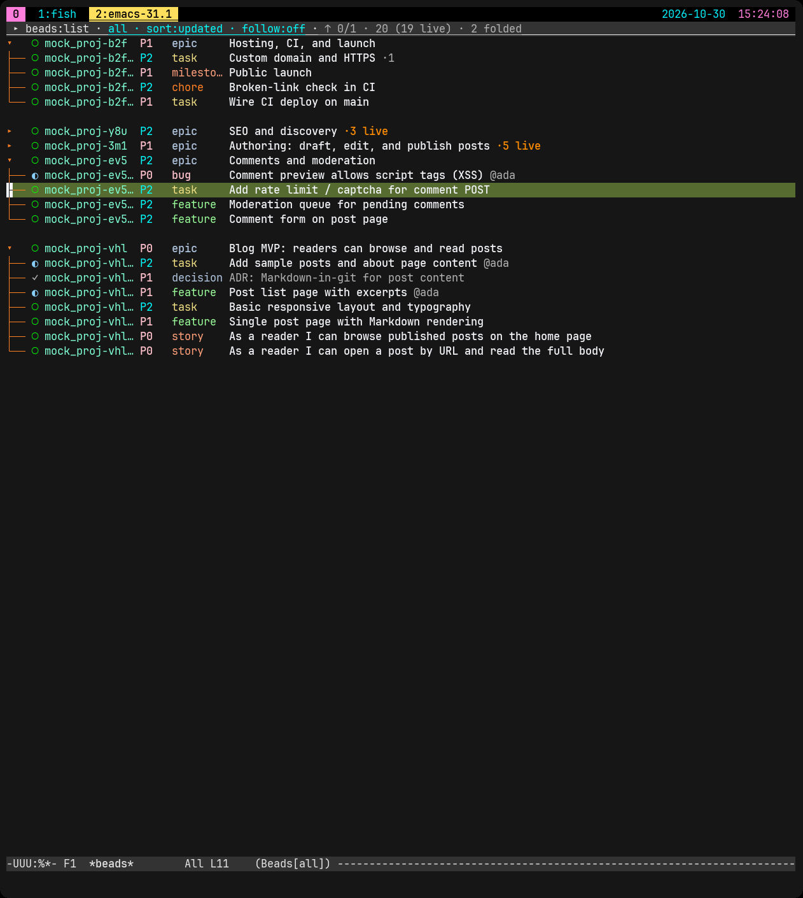
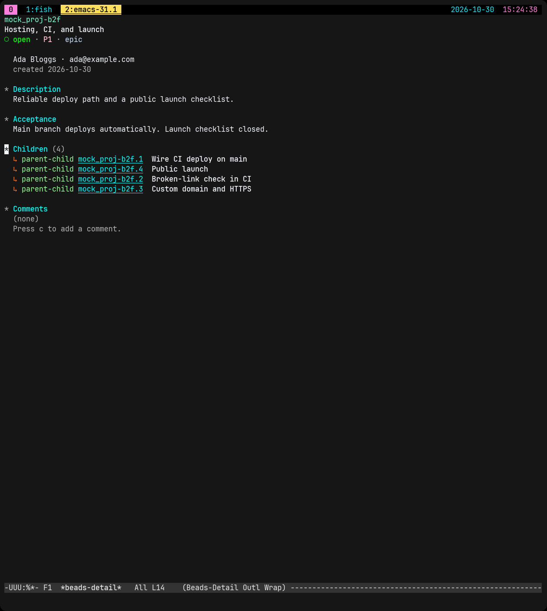

# beads.el

Emacs UI for [Beads](https://github.com/gastownhall/beads) (`bd`).

List buffer for issues. Detail buffer for one issue. Stock Emacs buffers and keys where they fit. Writes: claim, comment, create, close, status, title, reparent.

The product is the Emacs package under `lisp/` (`M-x beads` and related commands). `scripts/agents.py` is an optional legacy helper, not required, and not covered by `make verify`.



*List buffer (`beads:list`) — issues and epics grouped by parent, with status, priority, and type.*



*Detail buffer — one issue (here an epic) with Description, Acceptance, Children, and Comments.*

## Requirements

- Emacs 29.1 or newer
- `bd` on `PATH`
- `bd` at least `beads-bd-min-version` (default `"0.1.0"` in `lisp/beads-cli.el`). Set the custom to `nil` to skip the check.

## Install

Not on MELPA yet. Install from GitHub or a local clone. A future MELPA recipe should ship only `lisp/` (exclude `scripts/` and `test/`).

### From GitHub

```elisp
(use-package beads
  :vc (:url "https://github.com/wnoronha/beads.el"
       :lisp-dir "lisp")
  :commands (beads beads-here beads-show))
```

Without `use-package`:

```elisp
(package-vc-install
 '(beads :url "https://github.com/wnoronha/beads.el"
         :lisp-dir "lisp"))
```

### From a local clone

```elisp
(add-to-list 'load-path "/path/to/beads.el/lisp")
(require 'beads)
```

## Quick start

Open a Beads project directory, then:

```text
M-x beads
```

Prefix to pick the project root:

```text
C-u M-x beads
```

- `RET` opens the issue in the detail buffer.
- `q` in detail returns to the list.
- `q` in the list closes the session.
- `?` or `C-h m` shows the mode help and key map.

Default layout is standalone (separate list and detail buffers). For a split:

```elisp
(setq beads-layout 'stacked    ; or 'side-by-side
      beads-auto-follow t)
```

## Keys

Default style is `emacs` (`beads-keymap-style`). Most write commands use `C-c` prefixes. Set `beads-keymap-style` to `btu` for the older single-letter map. Full maps live in `C-h m`.

### List

| Key | Action |
|-----|--------|
| `n` / `p` | Move |
| `TAB` | Fold or unfold |
| `RET` | Open detail |
| `/` | Search |
| `g` | Refresh |
| `c` | Comment |
| `C-c C-a` | Claim |
| `C-c C-o` | Create |
| `C-c C-d` | Close (confirms) |
| `C-c C-s` | Set status |
| `C-c C-t` | Set title |
| `C-c C-r` | Reparent (confirms) |
| `1` / `2` / `3` | Jump to Description / Links / Comments in detail |
| `q` | Quit session |
| `?` | `describe-mode` |

### Detail

| Key | Action |
|-----|--------|
| `TAB` / `S-TAB` | Next / previous section |
| `z` | Fold section |
| `1` / `2` / `3` | Jump to Description / Links / Comments |
| `RET` | Follow link or issue id |
| `c` | Comment (`C-c C-c` submit, `C-c C-k` cancel) |
| `C-c C-a` | Claim |
| `C-c C-o` | Create |
| `C-c C-d` | Close (confirms) |
| `C-c C-s` | Set status |
| `C-c C-t` | Set title |
| `C-c C-r` | Reparent (confirms) |
| `g` | Refresh |
| `q` | Back to list |
| `?` | `describe-mode` |

Status marks: `○` open · `◐` in progress · `●` blocked · `✓` closed · `❄` deferred · `◈` pinned · `◇` hooked · `◌` other · `⊘` gated

## Config

```elisp
(setq beads-bd-executable "bd")
(setq beads-directory nil)         ; nil → use default-directory
(setq beads-actor nil)             ; nil → bd default actor
(setq beads-bd-min-version "0.1.0") ; nil → skip version check
(setq beads-layout nil)            ; nil | stacked | side-by-side
(setq beads-auto-follow nil)
(setq beads-keymap-style 'emacs)   ; or 'btu
(setq beads-tty-hide-menu-bar nil) ; t hides menu bar on TTY (global)
```

## Test and CI

```bash
make verify    # compile + ERT
make ert       # tests only
```

GitHub Actions runs `make verify` and `make check-autoloads` on push and pull requests.

Before tagging a release:

```bash
make autoloads
make check-autoloads
```

Commit a fresh `lisp/beads-autoloads.el` if `check-autoloads` reports it stale.

## Optional agent helper

`scripts/agents.py` can poll `bd ready` and start a harness agent. Config: `scripts/agents.ini`. Legacy and optional. Not part of `make verify`. You may replace it with a Lisp companion later.

```bash
make agents-dry-run
python3 scripts/agents.py --help
```

## Further reading

- [docs/bd-contract.md](docs/bd-contract.md): `bd` flags this package uses
- [docs/architecture.md](docs/architecture.md): write paths and list/detail module shape
- [CHANGELOG.md](CHANGELOG.md)

## License

MIT. See [LICENSE](LICENSE).
